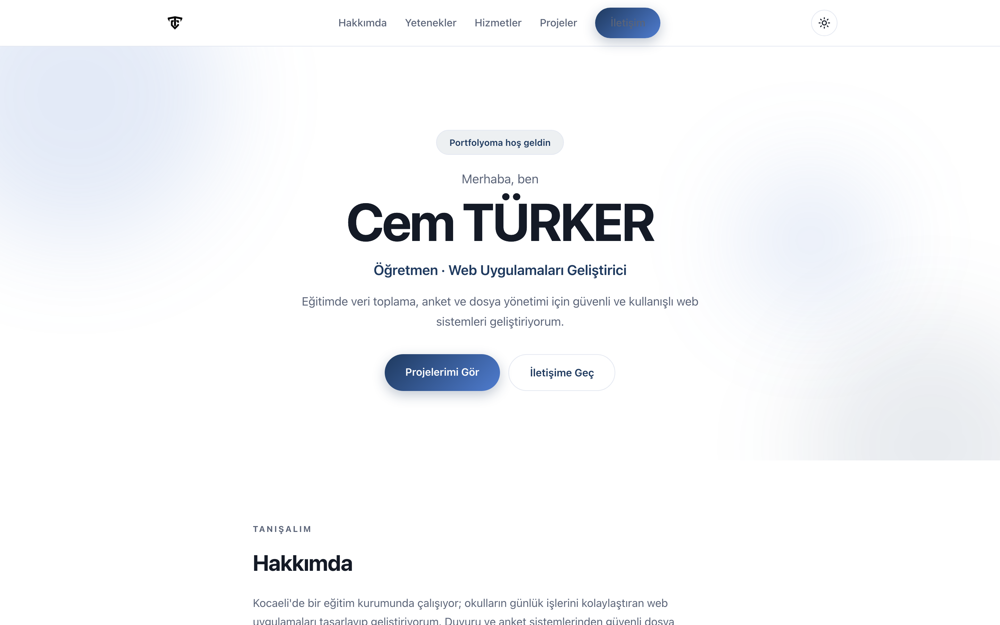
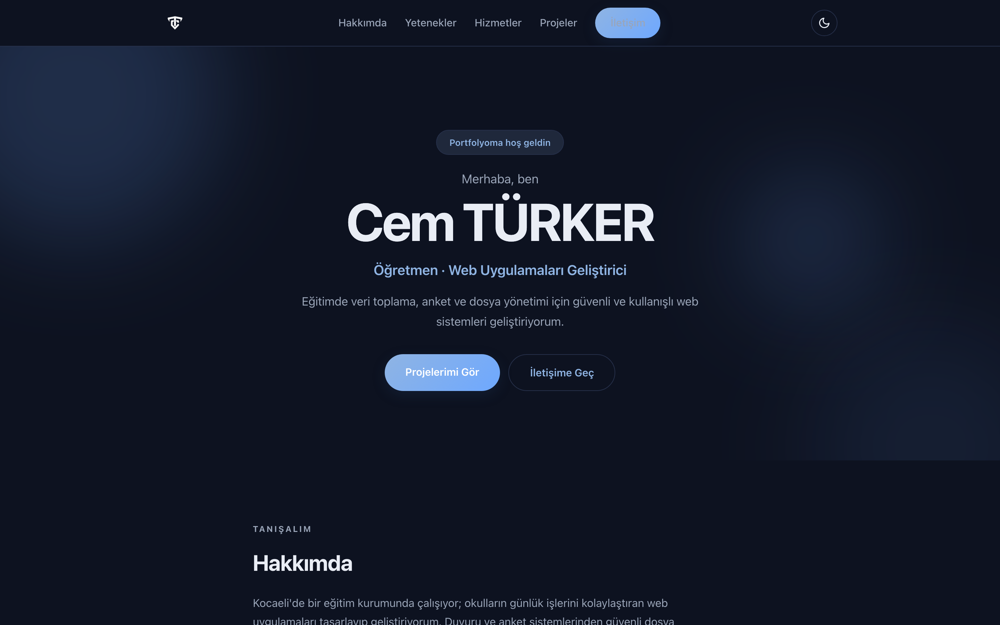

# Cem Türker — Portfolio

> A fast, dependency-free personal portfolio with light/dark themes, built with plain HTML, CSS and JavaScript.

[](https://developer.mozilla.org/docs/Web/HTML)
[](https://developer.mozilla.org/docs/Web/CSS)
[](LICENSE)

<p align="center">
  <a href="https://www.buymeacoffee.com/cmtrkr"></a>
</p>

This is the personal portfolio of **Cem Türker**, a teacher and web application developer in Kocaeli, Türkiye. It presents his background, skills, services and projects in a single static page. No framework, no build step, no tracking — just three files and a logo.

The design uses a responsive layout, a sticky navigation bar, a light/dark theme saved in `localStorage`, and scroll-reveal animations with `IntersectionObserver`.

## 📸 Screenshots

| Light theme | Dark theme |
| :---: | :---: |
|  |  |

Both images are real captures of the site at 1440×900.

## ✨ Features

- 🌗 **Light and dark themes** — respects `prefers-color-scheme` on first visit and remembers the choice.
- 📱 **Responsive layout** — hero, about, skills, services, projects and contact sections.
- 🎞️ **Scroll reveal** — subtle entrance animations via `IntersectionObserver`.
- 🧭 **Sticky navigation** — anchor links to every section with a mobile menu.
- 🪶 **No dependencies** — no npm, no bundler, no external CSS framework.
- 🔍 **SEO basics** — descriptive title, meta description, language and favicon.
- ♿ **Reduced motion friendly** — animation durations collapse for users who prefer reduced motion.

## 🚀 Run locally

Any static server works:

```bash
# Python
python3 -m http.server 8080

# Node
npx serve .
```

Then open `http://localhost:8080`.

Opening `index.html` directly also works, but use a local server so absolute asset paths (`/assets/logo.png`, `/style.css`) resolve correctly.

## 📁 Project structure

```text
portfolyo/
├── index.html          # All page content
├── style.css           # Layout, themes and animations
├── script.js           # Theme toggle, menu, reveal and year
└── assets/
    └── logo.png
```

## 🎨 Customization

- **Text and sections:** edit `index.html`.
- **Colors and spacing:** change the custom properties at the top of `style.css`.
- **Theme storage key:** `ct-theme` in `script.js` and the inline head script.
- **Accent color:** search for `--accent` in `style.css`.

## 🌐 Deployment

The site is fully static and can be hosted on GitHub Pages, Cloudflare Pages, Netlify or any web server. Upload the repository contents and point the server at `index.html`.

## ❤️ Support

If you find the layout or theme useful, you can buy me a coffee:

<p align="center">
  <a href="https://www.buymeacoffee.com/cmtrkr"></a>
</p>

## 📄 License

[MIT](LICENSE) © 2026 Cem Türker.
